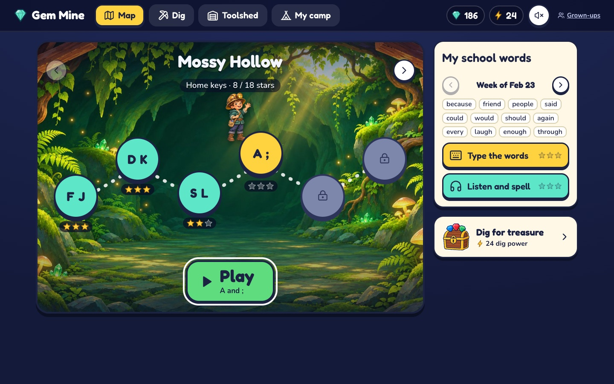
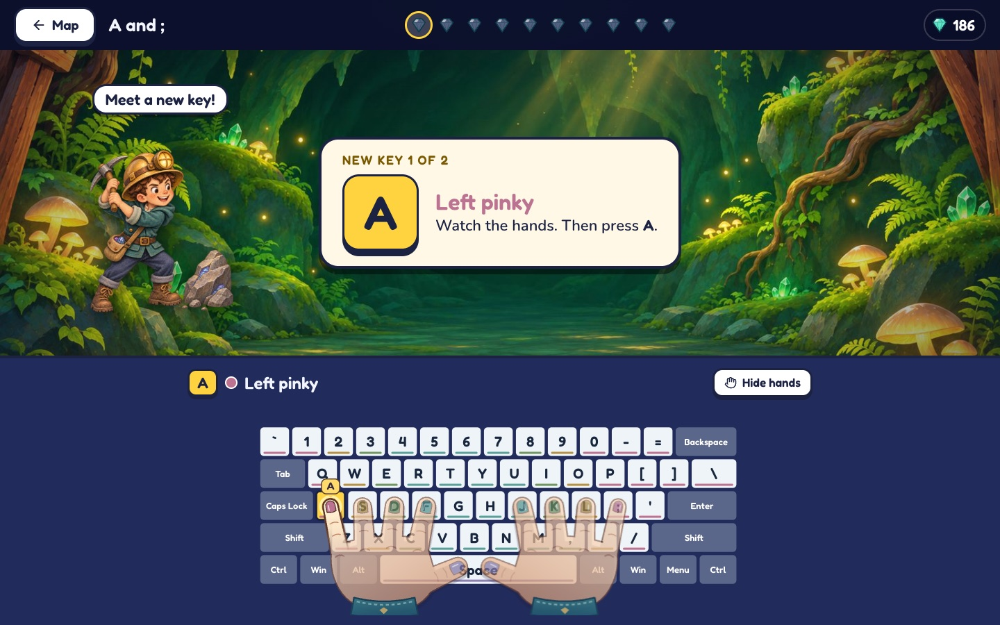
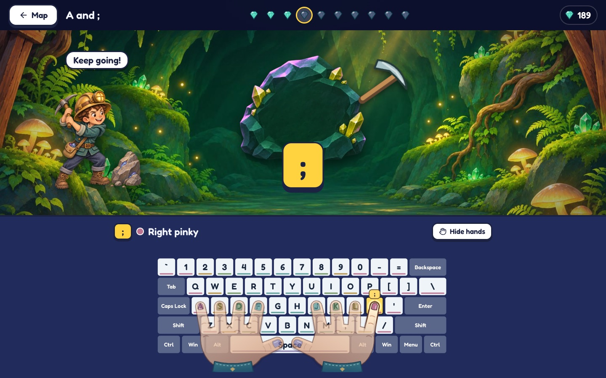
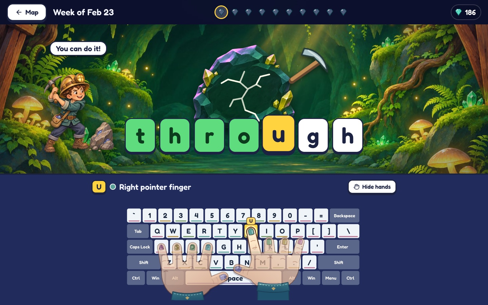
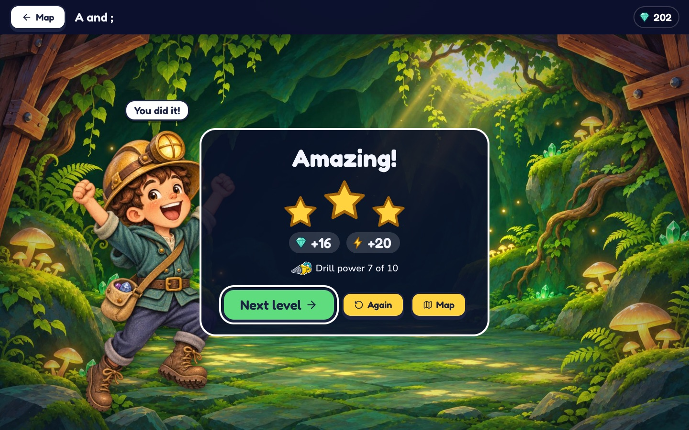
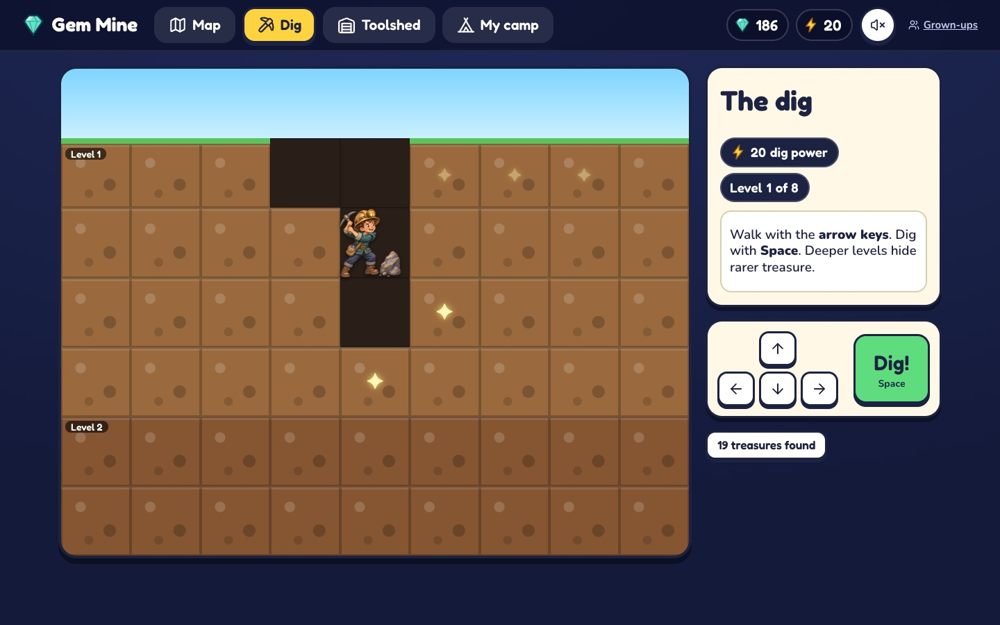
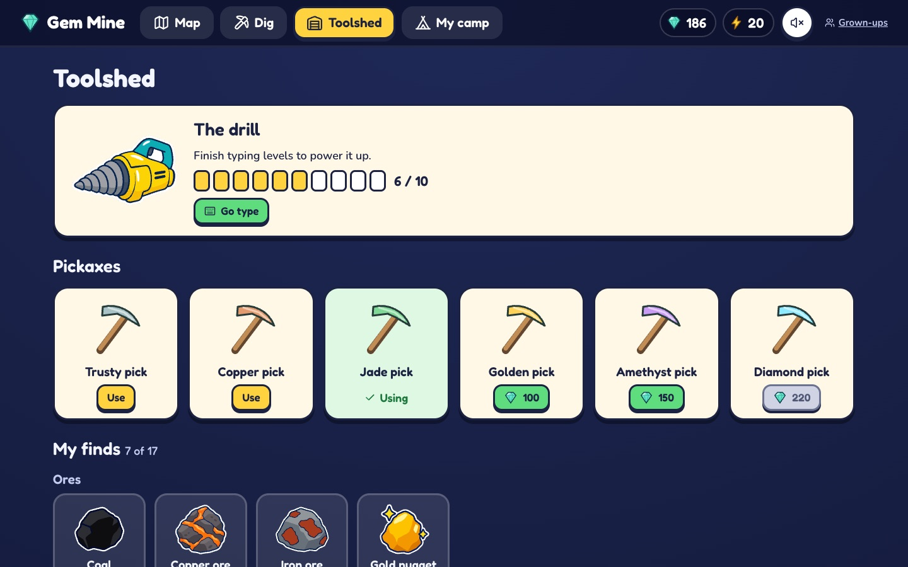
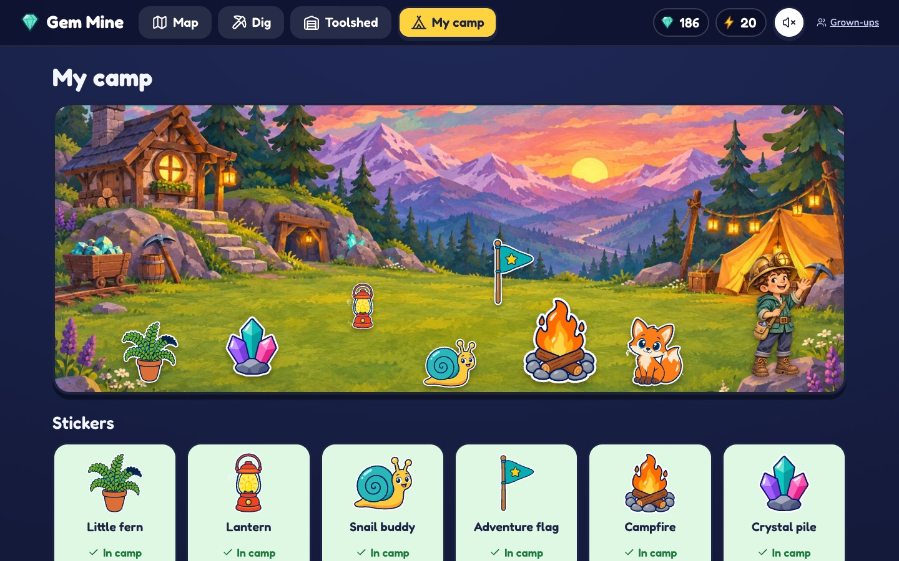
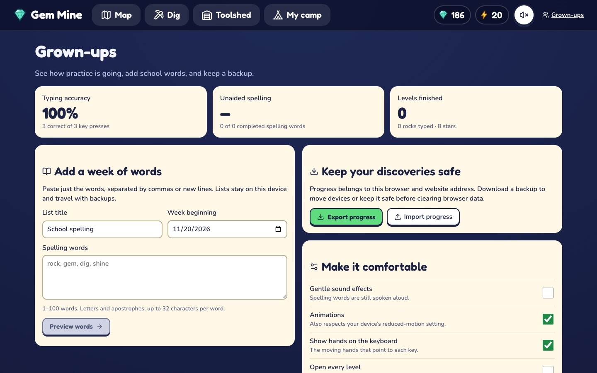
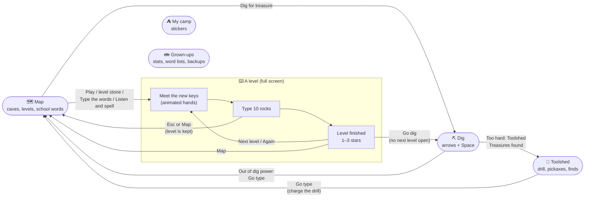

# Gem Mine

Gem Mine is an illustrated typing adventure for young learners. Kids follow a map of short key lessons, type their school spelling words, dig for treasure, and decorate a camp with what they earn. There are no accounts, no tracking, no backend and no timers. Everything stays in the browser.

**[Play it at msurguy.github.io/gem-mine](https://msurguy.github.io/gem-mine/)**



## Screenshots

| Meet a new key                                                                           | Type the rocks                                                                                                         |
| ---------------------------------------------------------------------------------------- | ---------------------------------------------------------------------------------------------------------------------- |
|     |               |
| **School words**                                                                         | **Level finished**                                                                                                     |
|  |  |
| **The dig**                                                                              | **Toolshed**                                                                                                           |
|             |                       |
| **My camp**                                                                              | **Grown-ups**                                                                                                          |
|    |                         |

## How the screens connect

The top bar on every screen except a level goes to **Map**, **Dig**, **Toolshed**, **My camp** and **Grown-ups**. The arrows below are the shortcuts inside the screens, and the loop between typing and digging is the core of the game: typing earns gems and dig power, digging spends dig power and finds treasure, and gems buy tools and stickers.



What moves between the screens:

| Earned in | What                                            | Spent in                                       |
| --------- | ----------------------------------------------- | ---------------------------------------------- |
| A level   | 💎 gems (one per rock, two per star)            | Toolshed (drill, pickaxes), My camp (stickers) |
| A level   | ⚡ dig power (two per rock)                     | Dig (one per swing)                            |
| A level   | 🔋 drill charge (one per finished level)        | Dig (cuts hard rock on levels 5–8)             |
| Dig       | 💎 treasure value, and the item in **My finds** | Toolshed shows the collection                  |

## Playing

Everything a child needs is one click (or one press of Enter) from the map.

- **Map:** four caves, each a trail of short levels. Mossy Hollow teaches the home keys two at a time (F J, D K, S L, A ;, G H), Crystal Cavern the top row, Amber Grotto the bottom row, Moonstone Deep numbers and apostrophes. Each cave ends with a level of real words made from the keys learned so far. A level opens when the one before it is finished; **Grown-ups → Open every level** removes that gate.
- **A level:** ten rocks. A level that teaches new keys first introduces each one with the animated hands. Typing works anywhere on the screen with no need to click or focus anything. Escape goes back to the map and the level is kept for later. Wrong keys flash on the keyboard and only cost stars.
- **Stars:** every finished level earns one to three stars for accuracy (90% for three, 70% for two). The best result is kept.
- **My school words:** pick a week, then **Type the words** (the word is shown) or **Listen and spell** (the word is spoken; **Show me** reveals it, and two misses reveal it automatically).
- **Dig:** walk with the arrow keys and dig with Space. Each swing uses one dig power. The dig has eight depth levels with different treasure in each: ores near the top, gold, dinosaur bones and fossils from level 3, gems and petrified wood below, and ancient coins, vases, necklaces and a golden mask at the bottom. Levels 5 to 8 are hard rock that only a powered drill can cut.
- **Toolshed:** the drill costs 100 gems and is powered by finishing 10 typing levels. Pickaxes are cosmetic. **My finds** shows every treasure dug up so far.
- **My camp:** spend gems on stickers for the camp picture.

Word lists keep their capitalization, but input is case-insensitive. Apostrophes are required, and curly apostrophes count as straight ones. Words that were missed come up more often.

The numbers that tune the game are constants at the top of `src/dig.ts` (drill cost, levels to power it, dig power, treasure chances) and `src/game.ts` (gems per rock and per star).

## Run locally

Requires Node.js 22.12 or newer.

```sh
npm install
npm run dev
```

Open the local URL shown by Vite. To check the project:

```sh
npm run typecheck
npm test
npm run build
npm run preview
npm run test:e2e
```

Browser tests use an installed Google Chrome and start the Vite dev server automatically. They cover complete levels, spelling, digging, the drill, purchases, reloads, backups, old and broken saves, small screens, and axe accessibility checks on every screen. Set `GEM_MINE_BASE_URL` to test an already-running server instead.

## Publish on GitHub Pages

1. Fork or push this repository.
2. In **Settings → Pages → Build and deployment**, choose **GitHub Actions**.
3. The **Deploy Gem Mine to Pages** workflow tests, builds and deploys `dist` on every push to `main`. Run it manually from Actions if the first push happened before Pages was enabled.

Assets use relative paths, so a repository subpath works, and all screens are in-app state, so no routing setup is needed.

## Your own spelling words

Use **Grown-ups → Add a week of words** to add lists (1–100 words, letters and apostrophes, up to 32 characters each). They are stored in the browser and included in backups.

To change the built-in weeks, edit `schoolLists` in `src/curriculum.ts`. Built-in words and the 1,284 common elementary spelling words in `scripts/spelling-words.txt` play recorded clips from `public/audio/words`. After adding words to either, record the new ones with:

```sh
OPENAI_API_KEY=... node scripts/generate-word-audio.mjs
```

This needs ffmpeg. Words without a recording use the browser's speech synthesis, which depends on the voices installed.

## Progress and backups

Progress saves automatically to `gem-mine:progress:v2` in the browser's local storage, including a level in progress. It belongs to the site origin, so localhost and GitHub Pages have separate saves.

In **Grown-ups**, **Export progress** downloads a versioned JSON backup, and **Import progress** shows a summary of a backup before replacing the current save. Imports are limited to 2 MB and validated first.

If storage is blocked or full, the game keeps going in memory and shows a warning with an export button. If a save is corrupt, it is left untouched and can be downloaded for recovery before restoring a backup or resetting.

## Technical notes

React, TypeScript and Vite, with no backend.

| File                                                                                                       | Role                                                 |
| ---------------------------------------------------------------------------------------------------------- | ---------------------------------------------------- |
| `src/game.ts`                                                                                              | Pure reducer for typing, rewards and the shop        |
| `src/dig.ts`                                                                                               | Pure logic for the dig                               |
| `src/curriculum.ts`                                                                                        | Caves, levels, word lists, tools and stickers        |
| `src/persistence.ts`                                                                                       | Validating, migrating, importing and exporting saves |
| `src/audio.ts`                                                                                             | Sound effects and spoken words                       |
| `src/MapScreen.tsx`, `PlayScreen.tsx`, `DigScreen.tsx`, `ShedScreen.tsx`, `CampScreen.tsx`, `GrownUps.tsx` | One file per screen                                  |
| `src/HandsKeyboard.tsx`, `src/fingers.ts`                                                                  | The on-screen keyboard and animated hands            |

`ProgressV2` is the saved state and `BackupV2` wraps it with a format, version and export time. Saves and backups from the first version are migrated on load.

Accessibility: native controls, a keyboard-only path through every screen, on-screen buttons for the dig, visible focus, text alternatives, a sound toggle, and both system and in-game reduced motion.

## Credits

- Painted cave backgrounds, the camp and the miner poses were generated with the OpenAI Images API. The sticker-style SVGs in `public/art/stickers` were generated with [Quiver](https://quiver.ai) and cleaned up by hand.
- Spoken words in `public/audio/words` were recorded with OpenAI text-to-speech.
- Sound effects in `public/audio/sfx` are from SFX Kit, released under [CC0](public/audio/sfx/LICENSE.txt).
- Icons are from [Lucide](https://lucide.dev). Fonts are Fredoka and Nunito from Google Fonts.

## License

[MIT](LICENSE) © Maksim Surguy. The sound effects in `public/audio/sfx` are CC0.
